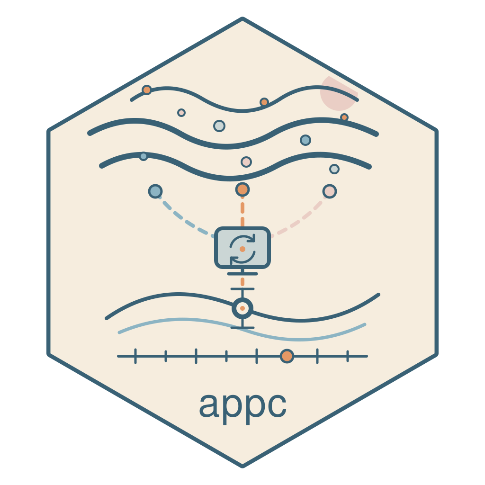

<!-- README.md is generated from README.Rmd. Please edit that file -->

```{r, include = FALSE}
knitr::opts_chunk$set(
  collapse = TRUE,
  comment = "#>",
  fig.path = "man/figures/README-",
  out.width = "100%"
)
```

# Air Pollution Prediction Commons 

<!-- badges: start -->
[](https://github.com/geomarker-io/appc/actions/workflows/R-CMD-check.yaml)
[](https://geomarker-io.r-universe.dev/appc)
[](https://lifecycle.r-lib.org/articles/stages.html#stable)
<!-- badges: end -->

## About

The goal of the appc package is to provide daily, high resolution, near real-time, model-based ambient air pollution exposure assessments.
This is achieved by training a generalized random forest on several geomarkers to predict daily average EPA AQS concentrations from 2017 until the near-present (currently June 2026) at exact locations across the contiguous United States (see `vignette("cv-model-performance")` for more details).

APPC collects and harmonizes EPA AQS outcomes and handles model development, evaluation, and prediction.
The [geomarker package](https://geomarker.io/geomarker/) supplies the environmental predictors.

This development version prepares model generation 3 using geomarker **0.2.0**, with coverage from January 1, 2017 through June 30, 2026.
Build the v3 training data and model before running predictions from this branch.
The published v2 model and its performance results belong to [APPC v2.0.1](https://github.com/geomarker-io/appc/tree/v2.0.1).

## Installing

Install the latest stable release of appc from R-universe with:

```r
install.packages("appc", repos = c("https://geomarker-io.r-universe.dev", "https://cloud.r-project.org"))
```

Install the latest, under-development version of appc from GitHub with:

```r
# install.packages("remotes")
remotes::install_github("geomarker-io/appc")
```

## Example

In R, create model-based predictions of ambient air pollution concentrations at exact locations on specific dates using the `predict_pm25()` function:

```{r, eval=FALSE}
#| message: true
appc::predict_pm25(
  x = s2::as_s2_cell(c("8841b39a7c46e25f", "8841a45555555555")),
  dates = list(as.Date(c("2025-05-18", "2025-06-10")), as.Date(c("2025-06-22", "2025-09-20")))
)
```

See more examples in `vignette("timeline-example")`.

## S2 Geometry

The [S2Geometry](https://s2geometry.io/) library is a [hierarchical](https://s2geometry.io/devguide/s2cell_hierarchy.html) geospatial index that uses [spherical geometry](https://s2geometry.io/about/overview).
Users familiar with latitude and longitude are probably accustomed to thinking of the Earth as a grid of (lat, lon) points and doing spatial calculations by projecting those points into planar coordinates.
The S2Geometry library is faster and more portable, and usually just as accurate.
S2 models earth as a sphere and represents locations as hierarchical cells on that sphere.
At a high level, earth is projected onto the faces of a cube and those faces are recursively subdivided into smaller square cells, each with their own unique ID (often represented as a 64-bit integer or a hex string).
Higher "levels" mean smaller cells (finer spatial resolution) and "geohash" usually refers to a s2 cell identifier in this context.
the s2 geohash cell encodes both *location and resolution*.

The appc package uses s2 cells via the [s2](https://r-spatial.github.io/s2/) package to specify geospatial locations.
In R, s2 cells can be [created](https://r-spatial.github.io/s2/reference/s2_cell.html#ref-examples) using their character string representation, or by specifying latitude and longitude coordinates; e.g.:

```{r}
s2::s2_lnglat(c(-84.4126, -84.5036), c(39.1582, 39.2875)) |> s2::as_s2_cell()
```

By default, s2 cells are created as "leaf-level cells", which is the highest level of resolution (30); these cells have areas of about 0.74 cm squared, and are best thought of as a point at this high resolution.
Find more [s2 cell statistics](https://s2geometry.io/resources/s2cell_statistics) in the S2Geometry documentation.
Another useful resource is the [S2 Region Coverer Online Viewer](https://igorgatis.github.io/ws2/), which can generate combinations of s2 cells that cover arbitrary drawn map boundaries or map combinations of cell identifers.

## Geomarker Assessment

Spatiotemporal geomarkers are used for predicting air pollution concentrations, but also serve as exposures or confounding exposures themselves. View information and options about each geomarker:

| geomarker | geomarker function |
|-----------|---------------|
| 🌦 weather & atmospheric conditions | `get_gridmet_data()`, `get_narr_data()` |
| 🛰 satellite-based aerosol diagnostics | `get_merra_data()` |
| 🔥 wildfire smoke | `get_smoke_summary()` |
| 🗻 elevation | `get_elevation_summary()` |
| 🏙 land cover | `get_nlcd_fct_imp_summary()` |
| 🚦 traffic | `get_traffic_summary()` |
| 🏭 emissions | `get_nei_point_summary()` |

## Data storage

Environmental downloads and assessment are managed by geomarker under its own R user data directory.
See [geomarker's data and offline-operation documentation](https://geomarker.io/geomarker/) for cache and source-refresh options.
APPC retains AQS outcomes, assembled training data, and fitted models under `tools::R_user_dir("appc", "data")`.
Set `R_USER_DATA_DIR` to choose a different root for both packages.

## Developing

The committed workflow has two steps:

```sh
just make_training_data
just train_model
```

The first script downloads and harmonizes AQS outcomes, calls the shared geomarker-backed predictor assembler, prints coverage/missingness summaries, and saves `training_data_v3.rds`.
The second reads that table and fits the existing GRF specification, saving `rf_pm_v3.rds`.
These are large, manually invoked jobs. Neither is run by package checks.

Training requires geomarker 0.2.0 from release commit `373820d0ab8082f856f7bf0f639f3128111d825a`.
Install the exact dependency recorded in DESCRIPTION from the repository root:

```r
pak::pak(".")
```

The minimum runtime dependency is geomarker 0.2.0.
The exact version, release tag, source SHA, feature settings, and coverage are recorded in `inst/model-v3-spec.dcf`.
Training checks the installed version and source SHA; a development version number alone does not identify the code.
Artifacts preserve this specification, session information, and geomarker's source manifests.
Retain the assembled training artifact to reproduce fitting after upstream AQS or weather revisions.
Use a dedicated `R_USER_DATA_DIR` for an official build so existing local monthly MERRA overrides are not picked up unintentionally.
No automatic NASA source refresh is performed.

Existing artifact files are protected against overwriting.
Move an existing v3 artifact aside before rebuilding.
Local v3 predictions require metadata and predictor names matching the model specification.
Remote v3 model downloads remain disabled until a release artifact and checksum are registered.

After building the artifacts, set `APPC_BUILD_MODEL_ARTICLES=true` to execute model-dependent articles and run `just render_model_dash`.
Otherwise, article rendering displays a preparation notice without accessing model data.
The existing v2 performance report remains available with the [v2 release](https://github.com/geomarker-io/appc/blob/v2.0.1/docs/articles/cv-model-performance.html).
