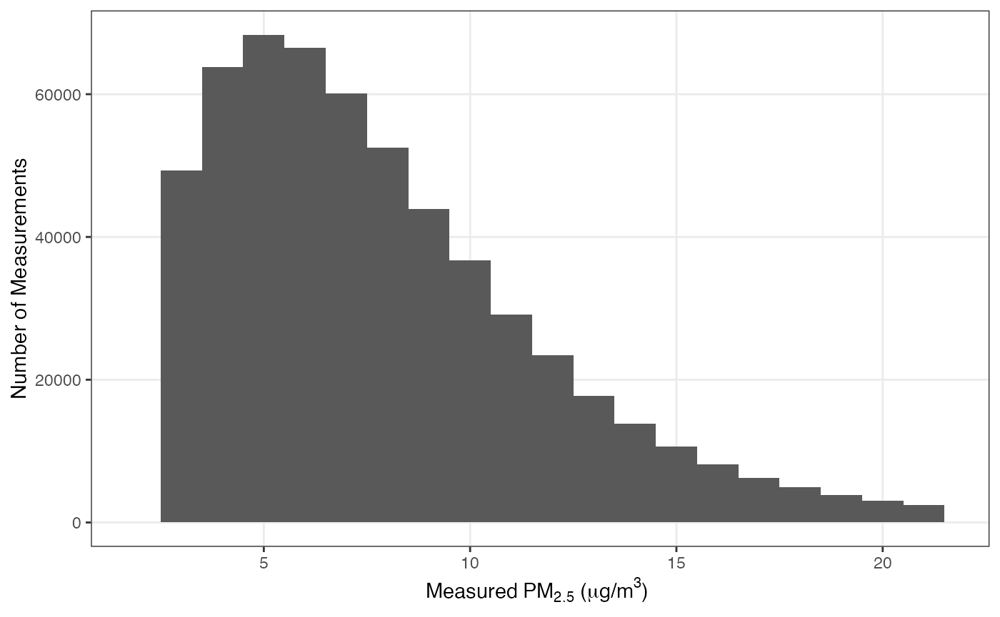

# CV Model Performance

This report evaluates model generation 3. Published v2 results are
retained with [APPC
v2.0.1](https://github.com/geomarker-io/appc/blob/v2.0.1/docs/articles/cv-model-performance.html).

The [model generation 3
release](https://github.com/geomarker-io/appc/releases/tag/rf_pm_v3)
pairs this forest with its training dataset, checksums, and model
specification. The environmental predictors were generated with
geomarker **0.2.0**, from release commit
**373820d0ab8082f856f7bf0f639f3128111d825a**. APPC collects and
harmonizes the EPA AQS outcomes.

## Training Data

Training data consisted of 618,918 daily average PM$`_{2.5}`$
concentrations from 786 EPA AQS monitors on 3,468 days between
2017-01-01 and 2026-06-30.

V2 covered the same dates using 611,572 observations at 783 locations.
V3 uses refreshed EPA outcomes, including Idaho and North Dakota in the
2026 API refresh. The comparison therefore describes performance over
the same period using slightly different evaluation records.

Overall, the median measured PM$`_{2.5}`$ was 6.9 $`\mu g/ m^3`$ and 95%
of all measurements were between 1.8 and 21.6 $`\mu g/ m^3`$:

## Model Training

The EPA AQS monitor concentrations were used to train a generalized
regression forest with 200 trees, a subsample fraction of 0.5, a minimum
node size of 5, and an $`m_{try}`$ value of 20.

Model predictors listed in the table below are ordered according to
their importance. Here, the variable importance is calculated as an
exponentially-weighted sum of how many times each feature was selected
within the first 6 splits of each tree in the forest.

| importance | predictor |
|---:|:---|
| 0.76 | merra_oc |
| 0.08 | merra_bc |
| 0.05 | hpbl |
| 0.03 | plume_smoke |
| 0.02 | x, temperature_max |
| 0.01 | wind_speed, merra_so4 |
| 0.00 | y, doy, year, elevation_median, elevation_sd, temperature_min, precipitation, solar_radiation, wind_direction, specific_humidity, merra_dust, merra_ss |

## Leave One Location Out (LOLO) Cross Validated Model Performance

Leave-one-location-out (LOLO) accuracy is calculated by using out of bag
predictions from the trained random forest with resample clustering by
the location. Accuracy is characterized using median absolute error
(`mae`) and the Spearman’s correlation coefficient (`rho`). Accuracy
metrics are calculated for each left out location and then summarized
using the median accuracy statistic across all locations. This most
closely captures the performance in a real-world scenario where we are
trying to predict air pollution between 2017 and 2026 in a place where
it was not measured.

Each AQS monitor has a different number of measurements depending on its
measurement frequency and when it was deployed. To calculate LOLO model
performance, we exclude any station or station-time grouping that has 4
or less observations. In the tables below, `median_n` represents the
median number of observations used in each station grouping to calculate
the overall median accuracy metrics. `ci_coverage` is the percentage of
the time that the 95% CI interval of the predicted concentration
contained the measured concentration.

### Daily

| mae |  rho | ci_coverage | median_n |
|----:|-----:|:------------|---------:|
| 1.2 | 0.84 | 69%         |      649 |

#### Actual PM2.5 Concentrations vs LOLO Daily Predictions

#### Daily Prediction Accuracies per Calendar Year

| year |  mae |  rho | ci_coverage | median_n |
|-----:|-----:|-----:|:------------|---------:|
| 2017 | 1.15 | 0.86 | 70%         |      117 |
| 2018 | 1.14 | 0.86 | 71%         |      117 |
| 2019 | 1.20 | 0.85 | 69%         |      116 |
| 2020 | 1.20 | 0.83 | 70%         |      115 |
| 2021 | 1.20 | 0.85 | 70%         |      116 |
| 2022 | 1.20 | 0.83 | 69%         |      117 |
| 2023 | 1.30 | 0.85 | 70%         |      116 |
| 2024 | 1.20 | 0.83 | 69%         |      117 |
| 2025 | 1.20 | 0.86 | 69%         |      118 |
| 2026 | 1.20 | 0.83 | 70%         |       57 |

### Monthly

Exclude stations with 4 or less total monthly observations.

|  mae |  rho | ci_coverage | median_n |
|-----:|-----:|:------------|---------:|
| 0.71 | 0.88 | 96%         |       78 |

### Annual

Exclude stations with 4 or less total annual observations.

|  mae |  rho | ci_coverage | median_n |
|-----:|-----:|:------------|---------:|
| 0.58 | 0.85 | 100%        |       10 |

### Median LOLO Accuracy Per Spatial Aggregation Period

Station-specific estimates of crossvalidated MAE and Rho were spatially
aggregated to level 5 s2 cells and summarized. The visualized result is
a rough approximation of how model performance may differ in different
parts of the country:

